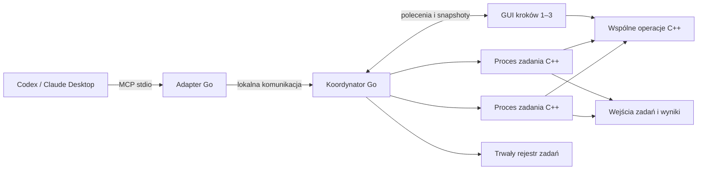

# MCP dla HDMapping — uzgodniony projekt

Data: 2026-11-15. Baza rozpoznania: `3d3a8054986f95fcf580ef0f780889043bfdd475`.
Status: decyzje użytkownika Q1–Q20 uzgodnione; niezależny przegląd wykonany, obie wskazane luki rozstrzygnięte. Plan zaakceptowany do pracy po jednej karcie w osobnym czacie; rozpoczęcie konkretnej karty następuje przez prompt użytkownika. Zasady przekazania: [README.md](README.md).

## Cel i zakres pierwszej kompletnej wersji

Zewnętrzny asystent w Codex lub Claude Desktop wykonuje lokalnie pełne przetwarzanie kroków 1–3 HDMapping. Może pracować bez okna albo na aktualnym, również niezapisanym stanie otwartej aplikacji. Oba sposoby korzystają z tych samych operacji C++ i dają takie same wyniki przy tych samych danych, ustawieniach i jawnie wskazanym zakresie.

Zadania mają własną tożsamość, postęp i trwały wynik. Zamknięcie asystenta lub GUI nie anuluje obliczeń. Równoległość jest konfigurowalna, domyślnie 2 ciężkie zadania; pozostałe oczekują. Jedna sesja/projekt może być modyfikowany tylko przez jedną operację naraz. Równoległe warianty tej samej pracy wymagają osobnych stanów roboczych.

Q20 obejmuje tymi regułami także ciężkie obliczenia uruchamiane istniejącymi przyciskami aktualnych GUI. Gdy MCP jest zbudowane, przycisk i narzędzie MCP uruchamiają ten sam rodzaj zadania; koordynator startuje na żądanie także bez uruchomionego asystenta. Awaria startu koordynatora ma być jawnym błędem, bez cichego uruchomienia ciężkiej operacji poza wspólnym limitem. Jest to świadoma zmiana sposobu wykonania GUI, z zachowaniem jego operacji, parametrów i wyników.

Pierwsza kompletna wersja obejmuje wszystkie niżej wymienione rodziny przetwarzania. Etapy implementacji nie oznaczają zgody na ogłoszenie samego kroku 1 jako gotowego zakresu MCP.

| Obszar | Rodziny operacji |
| --- | --- |
| Dane i stan | Rozpoznanie wejścia; tworzenie/otwieranie stanów roboczych; lista otwartych instancji; odczyt parametrów i niezapisanych zmian; jawne identyfikatory sesji, skanów i zakresów. |
| Krok 1 | Nagranie LiDAR/IMU, presety i TOML, przygotowanie, odometria, istniejące consistency/smoothing, chmury referencyjne i wstępne transformacje, zapis sesji/raportu, LAS/LAZ i trajektorie. |
| Krok 2 | Sesje i obsługiwane chmury, NDT/ICP/plane features/pose graph, więzy i ich parametry, ICP więzów, kandydaci BoW, segmenty LIO, CP/GCP, istniejące GNSS/NMEA/TUM i georeferencja, zapisy i eksporty. |
| Krok 3 | Projekty wielosesyjne, dodawanie/usuwanie sesji, ground truth, transformacje początkowe, NDT, kandydaci/aktywne więzy i ICP, optymalizacja grafu, przywracanie pozycji, zapis i eksport. |
| Zadania i wyniki | Uruchomienie, lista, postęp, anulowanie, raport, odczyt artefaktów, ponowne wykonanie, otwarcie wyniku w GUI, eksport pełnego zestawu danych. |

Zakres oznacza udostępnienie istniejących możliwości, nie dodanie nowych algorytmów. CP i GCP zachowują odrębne modele. Krok 3 nie dostaje automatycznie bezpośredniej fuzji GNSS, której nie ma w aktywnym kodzie. Obsługa współrzędnych obejmuje obecne tryby, nie obietnicę dowolnego EPSG. Dokładny katalog operacji i dostępnych parametrów należy wyprowadzić z kodu wszystkich trzech aplikacji przed ich udostępnieniem; żadna rodzina z tabeli nie może zniknąć milcząco.

Poza zakresem: sterowanie kamerą, widocznością i interaktywnym zaznaczaniem przez AI; asystent wbudowany w HDMapping; dostęp zdalny i wielu użytkowników; wznawianie algorytmu od iteracji po awarii. Użytkownik nadal może korzystać z dotychczasowego GUI, w tym zaznaczać dane ręcznie. MCP przekazuje numeryczne dane, transformacje i jawne identyfikatory dla operacji, które dotąd rozpoczynano kliknięciem.

## Rozważone podejścia i wybór

1. **Wybrane: Go dla MCP i koordynatora, C++ dla operacji i GUI.** Oficjalne SDK protokołu, brak interpretera w gotowym pakiecie, procesowa izolacja obliczeń. Koszt: dodatkowy toolchain i integracja jego zależności z produktem.
2. **Całość w C++.** Mniejsza różnorodność języków; dodatkowe ryzyko kwalifikacji biblioteki MCP. Rozpoznany `fastmcpp` jest beta, obsługuje stdio i ma nieudane części konfiguracji macOS upstream.
3. **Python + C++.** Oficjalne SDK, ale runtime i zależności do dostarczenia. Istniejące bindingi nie zastępują wymaganej pracy nad wspólnym API i GUI.

Wybór został dokonany w Q17. Szczegóły źródłowe są w `findings.md`, a uzasadnienie w ADR 0002. Ten pakiet planowania jest wersjonowany na forku na jawne polecenie właściciela; dokumentacja użytkowa produktu nadal należy do wiki.

## Podział odpowiedzialności

- Adapter MCP odpowiada za protokół, schematy i mapowanie wyników. Jego zakończenie nie kończy koordynatora. `stdout` zawiera tylko MCP.
- Koordynator działa lokalnie dla danego użytkownika systemu, uruchamiany na żądanie. Zarządza identyfikatorami, kolejką, procesami, rezerwacjami, rejestrem i publikacją wyników. Nie implementuje algorytmów ani parserów formatów HDMapping.
- Każde ciężkie zadanie ma osobny proces C++ i katalog pracy. Nie uruchamiamy równolegle obecnych globalnych stanów aplikacji w jednym procesie.
- Wspólne operacje C++ otrzymują jawne dane, parametry i zakres. Funkcje wyodrębnia się z GUI tylko w granicach potrzebnych danej operacji; nie powstaje ogólny rewrite aplikacji.
- Most GUI obsługuje stan na właściwym wątku aplikacji. Operacja aktualizuje zarówno model, jak i powiązane kontrolki; zmiany nie mogą zostać nadpisane przy kolejnej klatce. Podgląd i krótkie operacje lokalne nie wymagają stale uruchomionego koordynatora; ciężki przycisk w buildzie z MCP uruchamia go na żądanie zgodnie z Q20.

## Własność stanu i równoczesna praca

Poniższe reguły uszczegóławiają Q9–Q11, Q14 i Q19; szczegółowa reprezentacja jest propozycją autora.

- Otwarte GUI jest właścicielem swojego bieżącego stanu. MCP odczytuje i zmienia ten sam model przez most, nie przez ponowne wczytanie starszego pliku.
- Każdy otwarty stan otrzymuje stabilny identyfikator i rewizję przetwarzania. Ścieżka i tytuł okna nie są identyfikatorem. Dwa otwarcia tego samego pliku są odrębnymi stanami roboczymi; wspólny zapis na dysk podlega osobnej ochronie przed kolizją.
- Rewizja obejmuje parametry, poses, więzy i zależne sesje projektu. Zmiana kamery jej nie zmienia. Polecenie mutacji zawiera oczekiwaną rewizję; stan niezgodny powoduje błąd, bez automatycznego scalania.
- Przyjęcie operacji dla GUI rezerwuje jej stan również podczas oczekiwania w kolejce. Podgląd i anulowanie pozostają dostępne; konflikty mutacji zgłaszane są jawnie. Anulowanie zadania oczekującego zwalnia rezerwację. Odczytujące operacje nie zajmują wyłącznej rezerwacji.
- Zadanie otrzymuje kompletny snapshot danych przetwarzania: niezapisane poses, więzy, CP/GCP, parametry i zależności. Nie dzieli mutowalnych obiektów C++ z GUI.
- Bez GUI stan roboczy jest utrwalonym snapshotem przechowywanym przez koordynatora. Jego zmiany waliduje i wykonuje C++; koordynator podmienia rewizję dopiero po sukcesie. Sposób buforowania tego stanu jest decyzją implementacyjną.
- Wynik zadania dla GUI jest automatycznie stosowany, jeśli istnieje nadal ten sam stan o oczekiwanej rewizji. Inaczej zachowuje się wynik i zwraca informację o niezastosowaniu. Nowe okno o podobnej ścieżce nie jest automatycznie celem starego zadania.
- Zastosowanie wyniku aktualizuje podgląd, parametry i ścieżki nowego wyniku; nie zapisuje nic do wcześniejszych plików. Gdy okno zostało zamknięte, wynik można później otworzyć jako nowy stan.

Zakres MCP jest jawny. Jeżeli użytkownik poprosi o „widoczne skany”, most rozwiązuje ten wybór do konkretnego zestawu identyfikatorów przy określonej rewizji. Późniejsza zmiana widoku nie zmienia wejścia uruchomionego zadania. Istniejące znaczenie przycisków GUI i CLI pozostaje zachowane; nowe rozdzielenie `wykryj/dodaj/zastąp więzy` dotyczy jawnego kontraktu MCP.

## Przyjęcie, wykonanie i zakończenie zadania

Proponowane stany rejestru: `preparing`, `queued`, `running`, `cancelling`, `completed`, `failed`, `cancelled`, `interrupted`. Przygotowanie dużego wejścia również jest obserwowalne i możliwe do anulowania.

Uszczegółowienie autora po przeglądzie: od chwili zwrócenia ID w `preparing` zwykłe zamknięcie okna jest bezpieczne. Przed odpowiedzią źródło zakłada rezerwację danych i obowiązek ich przekazania; jeśli dane są jeszcze w pamięci GUI, jego proces pozostaje w tle po zamknięciu okna do czasu ukończenia lub jawnego anulowania przekazania. Zniknięcie okna nie usuwa tej rezerwacji ani cache. Dopiero po utrwaleniu całego wejścia koordynator może zwolnić proces źródłowy i przejść do kolejki. Awaria lub wymuszone zabicie tego procesu w trakcie przekazania oznacza zadanie przerwane, tak jak utrata innego procesu obliczeń; nie jest utożsamiane ze zwykłym zamknięciem okna.

1. Sprawdzenie operacji, zakresu, parametrów, rewizji, ścieżek i kolizji celu. Rejestracja identyfikatora żądania przed efektami ubocznymi.
2. Utrwalenie wejścia i rezerwacja jego zależności. Zadanie nie przechodzi do `queued`, dopóki jego wejście nie jest kompletne i niezależne od życia GUI.
3. Uruchomienie przy wolnym miejscu w limicie. Domyślne 2 nie oznacza gwarancji dostępnej pamięci; błąd zasobów ma jednoznaczny status i nie uszkadza innych zadań. Limit nie zmienia parametrów algorytmów.
4. Raportowanie etapów i liczników dostępnych w silniku; nie wylicza się pozornego procentu z liczby linii logu.
5. Walidacja i publikacja całego wyniku. Dopiero potem `completed`; zastosowanie do GUI ma osobny rezultat.

Ponowienie tego samego żądania z tym samym identyfikatorem i argumentami zwraca istniejące zadanie. Inne argumenty pod tym identyfikatorem są błędem. Polecenie „uruchom ponownie” tworzy nowe zadanie i nowy wynik. Te zasady są propozycją autora chroniącą przed podwójnym uruchomieniem po zerwaniu odpowiedzi.

Anulowanie najpierw żąda współpracującego zatrzymania; po określonym czasie można zakończyć izolowany proces. Częściowy wynik nie jest publikowany. Anulowanie nie zamyka GUI ani innych zadań. Gdy publikacja już się zakończyła, odpowiedź mówi, że zadanie jest ukończone — nie udaje skutecznego anulowania.

Koordynator zapisuje rejestr i przejścia przed zgłoszeniem sukcesu. Po restarcie rozpoznaje rzeczywiście żywe, własne procesy zadań, a utracone oznacza jako przerwane; sam PID nie wystarcza. Po awarii systemu nie kontynuuje iteracji i nie uruchamia automatycznie ponownie kosztownych zadań. Użytkownik może ponowić zadanie od początku. Dokładne odzyskiwanie po awarii samego koordynatora wymaga proof-of-concept przed integracją całego workflow.

## Dane, snapshoty i publikacja

Zwykły wynik ma własne `.mjp`, `.mjs`, poses i pozostałe zmienione dane. Referencje są przepisane tak, aby natywny loader otworzył wynik, a zapis nie zmieniał źródłowych poses. Niezmienione chmury mogą pozostać współdzielonymi zależnościami zgodnie z Q18; manifest wyniku pokazuje te zależności. Eksport pełnego zestawu kopiuje je i przepisuje referencje do samowystarczalnego katalogu.

Snapshot nie oznacza wyłącznie JSON. Chmury tylko w RAM, zmodyfikowane dane i cache potrzebne po zamknięciu GUI muszą zostać zmaterializowane. Koordynator przejmuje odpowiedzialność za czas życia danych, zanim zadanie stanie się gotowe. GUI nie może usunąć cache potrzebnego przyjętemu zadaniu. Zwykły hardlink nie gwarantuje niezmienności.

Propozycja autora: własne operacje współdzielą wyłącznie niezmienne wejścia i chronią ich czas życia; dane, których niezmienności nie da się zapewnić, materializują. Dla zewnętrznych zależności zapisuje się tożsamość/fingerprint i wykrywa ich zmianę przed użyciem/ponowieniem. Wynik zależny od usuniętych zewnętrznych chmur zgłasza brak zależności; nie deklaruje się, że zwykły wynik jest przenośnym archiwum. Dokładna technika kopiowania i współdzielenia wymaga pomiaru na realnych danych.

Wynik buduje się w katalogu tymczasowym na tym samym woluminie co cel, sprawdza referencje i odczyt natywnym loaderem, a następnie publikuje. Zastąpienie istniejącego wyniku wymaga jawnej operacji z kontrolą stanu celu; stary kompletny wynik pozostaje dostępny, dopóki nowy nie jest gotowy. Awaria zapisu nie może pozostawić projektu wskazującego częściowo nowy zestaw plików. Technika transakcji wielu plików jest zadaniem implementacyjnym, objętym testem przerwania.

Nie usuwa się automatycznie wejść ani opublikowanych wyników. Sprzątanie obejmuje wyłącznie własne, nieużywane dane tymczasowe; zależność od współdzielonych plików musi być uwzględniona. Proponowany rejestr i prywatne snapshoty nie zmieniają istniejących formatów publicznych.

## Interfejs MCP i komunikacja lokalna

Przykładowe rodziny narzędzi: lista instancji/stanów, otwarcie danych, odczyt i zmiana parametrów, jawne operacje kroku 1/2/3, kandydaci/CRUD więzów, start/status/cancel zadań, zapis/eksport/otwarcie wyników. Konkretne nazwy i grupowanie ustala implementujący po spisie operacji. Nie udostępnia się ogólnego wykonania kodu ani powłoki.

Argumenty i wyniki mają schematy; błędy rozróżniają m.in. nieprawidłowe wejście, zajęty/nieaktualny stan, zamknięte GUI, brak zależności, brak zasobów, nieudane obliczenia i anulowanie. Go waliduje protokół, C++ warunki dziedzinowe. Wartości domyślne i jednostki pochodzą z implementacji C++, bez drugiego ręcznie utrzymywanego zestawu w Go.

Start długiej operacji zwraca identyfikator zadania; postęp i wynik są dostępne później. Wymagane zachowanie nie zależy od opcjonalnego rozszerzenia MCP Tasks ani od timeoutu jednego `tools/call`. Wyniki MCP zawierają krótkie podsumowania, liczby i odnośniki/ścieżki artefaktów; nie przesyłają całych chmur w JSON.

MCP stdio jest wspólną, udokumentowaną drogą lokalną dla Codex i Claude Desktop. Prywatna komunikacja adapter–koordynator–GUI–worker musi działać na wszystkich trzech platformach, ograniczać dostęp do bieżącego użytkownika i odrzucać niezgodną wersję produktu. Wybór konkretnej biblioteki IPC i mechanizmu odłączenia procesu jest pozostawiony implementującemu, z obowiązkowym dowodem przeżycia zamknięcia obu klientów i GUI, zwłaszcza na Windows.

Obsługiwaną wersję MCP i SDK przypina się po sprawdzeniu obu hostów. Obecna specyfikacja to 2026-07-28; samo wsparcie tej wersji w SDK nie dowodzi, że obsługują ją oba hosty. Nie opieramy wymagań produktu na niezweryfikowanej możliwości klienta.

## Build, wydanie i zakres zmian

- CMake buduje i instaluje elementy Go oraz C++ w ramach jednego produktu. Propozycja autora: `BUILD_WITH_MCP`, domyślnie ON w kompletnym wydaniu; OFF zachowuje build dotychczasowego produktu bez Go.
- W wariancie OFF dotychczasowe GUI zachowuje dotychczasowy model wykonania. Wariant ON nie oferuje cichego obejścia wspólnego koordynatora. Stare CLI i aplikacje legacy zachowują swój kontrakt; limit 2 obejmuje zadania zarządzane przez nową integrację GUI/MCP, nie dowolne procesy uruchomione poza nią.
- Go jest udokumentowaną zależnością budowania, nie zależnością użytkownika pakietu. Wersja kompilatora, SDK i modułów jest przypięta; standardowy build po instalacji dokumentowanych pakietów nie wymaga ręcznego `go build`, `go get` ani skryptu przygotowawczego. Obsługa toolchainu na trzech platformach podlega sprawdzeniu przed przyjęciem konkretnej wersji.
- Uszczegółowienie autora w planie: CMake może użyć zgodnego kompilatora systemowego, a w innym przypadku automatycznie pobiera przypięte oficjalne archiwum Go i weryfikuje SHA256. Nie zakładać dostatecznej wersji Go w standardowym apt Ubuntu 24.04. Podczas niekompletnej implementacji opcja MCP pozostaje OFF; domyślne ON następuje dopiero po odbiorze całego zakresu.
- Biblioteki C++ i wersje formatów są wspólne z resztą HDMapping. Nowe biblioteki spełniają zasady `3rdparty`/pinned checksums; nie powstają prywatne kopie istniejącego JSON, PROJ ani OpenCV dla MCP.
- Jedna wersja z top-level CMake, istniejące workflow CI i platformowe pakowanie. Nowe cele: właściwe `add_subdirectory`, `hdmapping_install_app`, Windows `EXPECTED` i obecne macOS/CPack. Ostateczna liczba executable i nazwy są decyzją implementacyjną.
- Integracja dotyczy aktualnych aplikacji raylib kroków 1–3. Warianty `*_legacy` zachowują działanie; nie rozszerza się ich o nowe zdalne sterowanie.
- Dotychczasowe GUI, formaty, parametry CLI i domyślne wyniki pozostają zgodne. Nowe zachowania MCP są opisane w wiki. Narzędzia developerskie mają wpis w `scripts/README.md`.
- Zmiany dostarcza się w oddzielnych, przeglądalnych PR-ach po jednej odpowiedzialności; znalezione poboczne błędy mają własny minimalny fix/issue.

## Kryteria odbioru

1. Pełna ścieżka 1→2→3→eksport przez MCP, zarówno headless, jak i z GUI; macierz pokrycia obejmuje wszystkie rodziny operacji.
2. Ten sam zapis parametrów, zakres i dane dają równoważne wyniki przez wspólne operacje GUI/headless. Porównanie uwzględnia istniejącą niedeterministyczność numeryczną, ale nie zmienia tolerancji w celu ukrycia regresji.
3. Realne nagranie Underground Parking dla wejścia/kroku 1/2 oraz jawnie dobrany rzeczywisty zestaw wielu sesji dla kroku 3. Źródło kandydujące: publiczny OmniWarsaw (potwierdzone 30 katalogów nagrań, bez gotowego `.mjp`). Przed walidacją trzeba wybrać rzeczywiście nakładające się nagrania, przygotować sesje i potwierdzić natywny odczyt/bazowy wynik. Sam przykład jednego nagrania nie potwierdza zakresu wielosesyjnego. Dane pozostają poza repozytorium; nie zakłada się pobrania całego dużego archiwum do CI.
4. Niezapisane poses, więzy, CP/GCP i parametry z GUI trafiają do obliczeń; zmiany MCP od razu odzwierciedlają się w kontrolkach. Stara rewizja i kolizja zapisu nie nadpisują nowszych danych.
5. Dwa zadania na odrębnych stanach działają równolegle, trzecie oczekuje; źródła GUI/MCP współdzielą ten sam limit i kolejkę. Test izolacji pamięci/stanu, katalogów i błędów. Zmiana limitu nie przerywa już uruchomionych zadań — ogranicza następne starty (propozycja autora).
6. Zamknięcie Codex, Claude i wszystkich okien HDMapping nie kończy przyjętego zadania. Po ponownym połączeniu można znaleźć je po ID i odczytać wynik.
7. Anulowanie w kolejce, przygotowaniu, obliczeniach i zapisie nie zamyka GUI, nie uszkadza wejść i nie publikuje częściowego wyniku. Awaria/system restart pozostawia jednoznaczny stan i możliwość ponowienia.
8. Wynik otwiera się natywnie po zamknięciu procesu tworzącego. Pełny eksport otwiera się po odłączeniu katalogu źródłowego. Brak automatycznego nadpisywania wejść.
9. Czysty build, install i odczyt gotowego pakietu na Windows 11, macOS i Ubuntu 24.04. Odbiór hostów na ich oficjalnie wspieranych platformach; na Ubuntu, jeśli Claude Desktop nie jest oficjalnie dostępny, użycie zgodnego klienta testowego uzupełnia test Codex, bez udawania testu Claude.
10. Testy logiki kontraktów i integracji protokołu/procesów; rzeczywiste ręczne sprawdzenie GUI na Windows. Bez testów odtwarzających rysowanie lub układ kontrolek. CI, formatowanie i realne dane wymagane przed PR/merge zgodnie z AGENTS.md.

## Pozostawione implementującemu

Nazwy narzędzi i klas; dokładne schematy prywatnego IPC/rejestru; wybór biblioteki IPC; przypięte wersje Go/SDK po sprawdzeniu zgodności; metoda snapshotów i publikacji spełniająca opisane gwarancje; rozsądny timeout anulowania; metody raportowania postępu w istniejących algorytmach. Nie obejmuje to prawa do zmniejszenia zakresu 1–3, rezygnacji z GUI, trwałości zadań lub równoległości.

## Źródła

- Lokalne źródła i miejsca integracji: `findings.md`; decyzje użytkownika: `design-tree.md`; słownik: `GLOSSARY.md`.
- [MCP — specyfikacja](https://modelcontextprotocol.io/specification/2026-07-28), [SDK](https://modelcontextprotocol.io/docs/sdk), [Go SDK](https://github.com/modelcontextprotocol/go-sdk).
- [Codex MCP](https://learn.chatgpt.com/docs/extend/mcp?surface=cli), [lokalne serwery Claude Desktop](https://modelcontextprotocol.io/docs/2026-07-28/develop/connect-local-servers).

To projekt oparty na analizie kodu i dokumentacji, nie dowód działania implementacji. Nie przeprowadzono buildu, benchmarku ani wykonania pipeline w tej sesji planowania.
